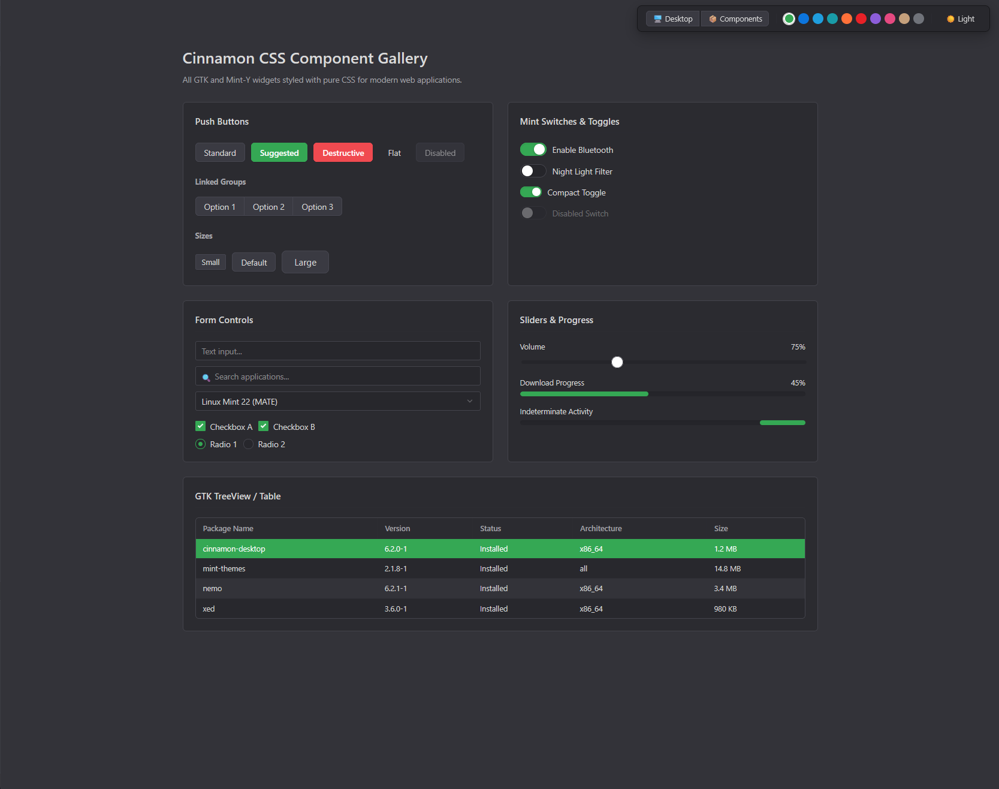

# 🌿 Cinnamon CSS

A modern, zero-dependency CSS library that faithfully emulates the **Linux Mint Cinnamon** desktop environment and the **Mint-Y / Mint-L** design system for web applications.

Whether you're building a web application that wants the clean, refined aesthetic of native Linux Mint GTK apps or an in-browser operating system simulation, **Cinnamon CSS** provides the design tokens, components, and optional micro-scripts to do it.



---

## ✨ Features

- **Dual Mode**:
  - **GTK App Mode**: For standard web applications, dashboards, forms, and settings dialogs.
  - **Desktop Shell Mode**: For browser OS simulations with panels, start menus, draggable windows, desktop icons, and applets.
- **Authentic Mint-Y Aesthetics**: Exact color palettes, corner radii (6px), headerbars, shadows, and the iconic Mint toggle switch.
- **10 Mint Accent Themes**: Mint Green (default), Blue, Aqua, Teal, Orange, Red, Purple, Pink, Sand, and Grey.
- **Light & Dark Themes**: Native `[data-theme="dark"]` support.
- **100% Pure CSS**: Zero runtime JavaScript dependencies. Embedded vector icons and clean CSS custom properties. Use with any framework (React, Vue, Svelte, vanilla HTML).

---

## 🚀 Quick Start

### 1. Installation

```bash
npm install cinnamon-css
```

### 2. Basic Setup

Add `cin-body` to your `<body>` or wrap your application in `.cin-app`:

```html
<!DOCTYPE html>
<html lang="en">
<head>
  <meta charset="UTF-8">
  <link rel="stylesheet" href="cinnamon.min.css">
</head>
<body class="cin-body">
  <button class="cin-btn cin-btn-suggested">Suggested Action</button>
</body>
</html>
```

---

## 🎨 Theming & Accents

### Dark Mode
Set `data-theme="dark"` on `<html>` or `<body>`:
```html
<html data-theme="dark">
```

### Accent Colors
Change the accent color by setting `data-accent="..."` on any container:
```html
<html data-accent="blue">   <!-- Blue accent -->
<html data-accent="aqua">   <!-- Aqua accent -->
<html data-accent="orange"> <!-- Orange accent -->
<html data-accent="red">    <!-- Red accent -->
```

Supported accents:
- `mint` (default)
- `blue`
- `aqua`
- `teal`
- `orange`
- `red`
- `purple`
- `pink`
- `sand`
- `grey`

---

## 📦 Component Overview

### Buttons
```html
<!-- Standard Button -->
<button class="cin-btn">Standard</button>

<!-- Mint Green Suggested Action -->
<button class="cin-btn cin-btn-suggested">Save Changes</button>

<!-- Destructive Action -->
<button class="cin-btn cin-btn-destructive">Delete</button>

<!-- Flat Toolbar Button -->
<button class="cin-btn cin-btn-flat">Refresh</button>

<!-- Linked Button Group (gtk-linked) -->
<div class="cin-btn-group">
  <button class="cin-btn is-active">Day</button>
  <button class="cin-btn">Week</button>
  <button class="cin-btn">Month</button>
</div>
```

### Mint Toggle Switch
```html
<label class="cin-switch">
  <input type="checkbox" class="cin-switch-input" checked>
  <div class="cin-switch-track">
    <div class="cin-switch-thumb"></div>
  </div>
  <span class="cin-switch-label">Enable Bluetooth</span>
</label>
```

### Inputs & Search
```html
<!-- Text Input -->
<input type="text" class="cin-input" placeholder="Enter name...">

<!-- Search with Icon -->
<div class="cin-search-box">
  <span class="cin-search-icon">🔍</span>
  <input type="text" class="cin-input" placeholder="Search...">
</div>

<!-- Checkbox -->
<label class="cin-checkbox">
  <input type="checkbox" checked>
  <span>Auto-update</span>
</label>

<!-- Range Slider -->
<input type="range" class="cin-slider" value="75">

<!-- Progress Bar -->
<div class="cin-progress">
  <div class="cin-progress-bar" style="width: 60%;"></div>
</div>
```

### Window Frame (CSD / Metacity Titlebar)
```html
<div class="cin-window" id="myWindow" style="width: 500px; height: 320px;">
  <header class="cin-titlebar">
    <div class="cin-titlebar-left">
      <span class="cin-titlebar-icon">📁</span>
    </div>
    <div class="cin-titlebar-center">
      <span class="cin-titlebar-title">Document Viewer</span>
    </div>
    <div class="cin-titlebar-right">
      <div class="cin-window-controls">
        <button class="cin-win-btn cin-win-btn-min">
          <svg viewBox="0 0 12 12"><line x1="2" y1="6" x2="10" y2="6"/></svg>
        </button>
        <button class="cin-win-btn cin-win-btn-max">
          <svg viewBox="0 0 12 12"><rect x="2" y="2" width="8" height="8" rx="1" fill="none"/></svg>
        </button>
        <button class="cin-win-btn cin-win-btn-close">
          <svg viewBox="0 0 12 12"><path d="M3 3L9 9M9 3L3 9"/></svg>
        </button>
      </div>
    </div>
  </header>
  <div class="cin-window-body">
    <div class="cin-window-content">
      Window content goes here...
    </div>
  </div>
</div>
```

### System Settings Preferences Card
```html
<div class="cin-pref-card">
  <div class="cin-pref-row">
    <div class="cin-pref-icon">🌙</div>
    <div class="cin-pref-info">
      <div class="cin-pref-title">Dark Theme</div>
      <div class="cin-pref-desc">Switch between light and dark UI</div>
    </div>
    <div class="cin-pref-action">
      <label class="cin-switch">
        <input type="checkbox" class="cin-switch-input" checked>
        <div class="cin-switch-track"><div class="cin-switch-thumb"></div></div>
      </label>
    </div>
  </div>
</div>
```

---

## 🛠️ Development & Demo

To run the interactive demo server locally:

```bash
npm install
npm run dev
```

Then open `http://localhost:5173` in your browser.

To build the library:
```bash
npm run build
```

---

## 📄 License

MIT
